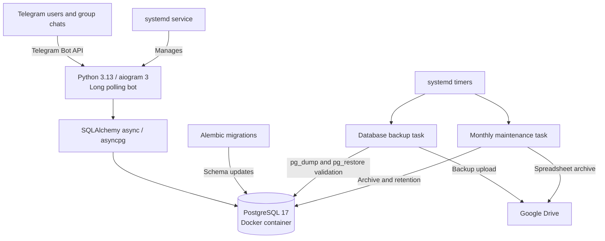
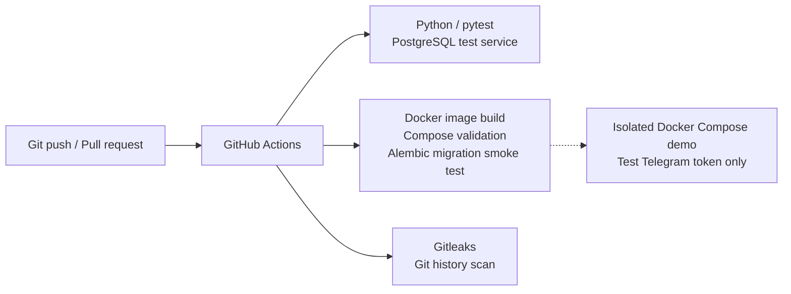

# Expense Bot

A production-operated Telegram expense tracker built with **Python 3.13, aiogram 3, PostgreSQL 17, SQLAlchemy and Alembic**.

## Features

- Track expenses by category, amount and date
- Shared budgets with Telegram members, chat and topic support
- Statistics and spreadsheet export
- Soft deletion of expenses
- Monthly archive and data retention workflows
- PostgreSQL custom-format backups, archive validation and Google Drive upload
- Automated tests with GitHub Actions and PostgreSQL

## Architecture

### Production architecture

### Development and quality checks

> The production bot runs as a systemd service; Docker Compose is provided for an isolated demo and CI validation. Google Drive credentials, database dumps, and expense data are not included in this repository.

## Local demo with Docker Compose

**Use a separate test Telegram bot token.** Never run the demo and production instance with the same token: long polling instances will conflict.

1. Copy `.env.example` to `.env` and set `BOT_TOKEN` and `POSTGRES_PASSWORD`.
2. Run `docker compose -f compose.demo.yml --env-file .env up -d --build`.
3. Inspect logs with `docker compose -f compose.demo.yml logs -f bot`.
4. Stop with `docker compose -f compose.demo.yml down`.

The demo stack runs PostgreSQL privately on its own Docker network, applies Alembic migrations before starting the bot, and persists the database in a named volume. Do not use `down -v` unless you explicitly intend to delete demo data.

> Passwords used in the example connection URL should be URL-safe. The Compose demo is separate from the existing production deployment.

## Existing production deployment

The current production installation runs the Python bot through a dedicated **systemd** service and PostgreSQL 17 in Docker. Separate systemd timers schedule database backup and monthly maintenance. The demo Compose stack is **not** the production deployment procedure.

The backup task currently relies on production-specific paths and a container name; monthly maintenance uses a configured-in-code budget ID. These tasks are not part of the standalone demo Compose stack.

## CI

GitHub Actions runs Python compilation and `pytest` against PostgreSQL 17 on pushes and pull requests. See `.github/workflows/ci.yml`.

## Security

- Do not commit `.env`, OAuth tokens, private keys, backups or expense exports.
- Treat database dumps and spreadsheets as sensitive personal data.
- Audit **Git history**, not just the current working tree, before making this repository public.
- Never reuse production credentials in a demo environment.

## Planned improvements

- Parameterize backup container/database names and archive budget IDs
- Preserve local backups on cloud-upload failures
- Extend container build and migration smoke tests with runtime integration tests
- Add a restore drill and deployment runbook
